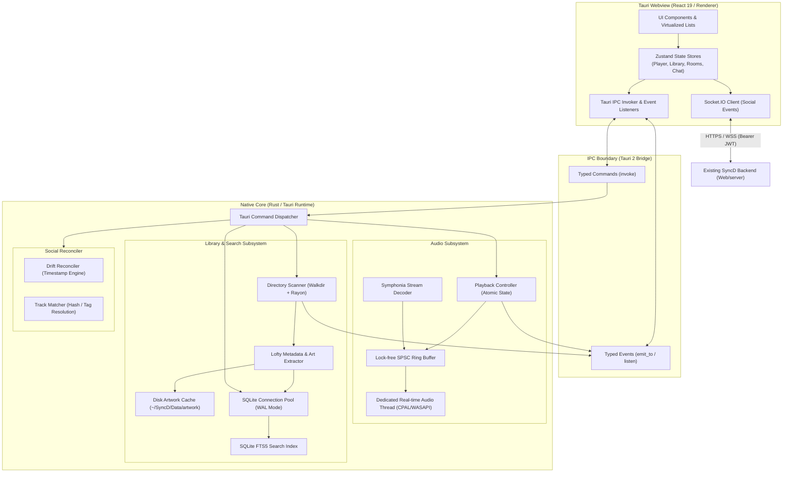

# SyncD Desktop — System Architecture Specification

## 1. Executive Summary & Vision

SyncD Desktop is a high-performance, native desktop music application and social listening hub engineered for Windows (with architectural design supporting future macOS and Linux ports). It seamlessly combines:

1. **Local-First Personal Music Management:** High-throughput background directory indexing, tag and metadata extraction, embedded artwork caching, SQLite-based library persistence with FTS5 search, and low-latency native audio playback.
2. **Social Listening & Synchronized Playback:** Real-time presence, shared room queue management, chat, and room-synchronized playback coordinating with the existing SyncD Web client and authoritative Node.js/PostgreSQL backend.

### Strict Non-Goals & Restrictions
- **No Artificial Intelligence:** Absolutely zero AI models, assistants, recommendation algorithms, generative playlists, or synthetic themes.
- **No Web View Wrappers:** No Electron, no HTMLAudioElement primary playback, no Expo/Expo-AV. The UI runs inside Tauri 2 while the audio engine, library scanner, and storage run purely in native Rust.
- **No Direct Audio Streaming over WebSockets:** Socket.IO is strictly for control and signaling. Audio bytes never pass through Socket.IO.

---

## 2. Repository Structure & Boundary Enforcement

The repository preserves the existing `Web/` ecosystem while establishing `Desktop/` as an isolated, standalone application.

```text
SyncD/
├── .github/
│   └── workflows/
│       ├── web-ci.yml           # Migrated from Web/.github/workflows/ci.yml with path filters
│       └── desktop-ci.yml       # Standalone Desktop validation (Types, Lint, Rust test/clippy)
├── .gitignore                   # Root repository & cross-platform ignore rules
├── Desktop/                     # Completely isolated desktop application
│   ├── src/                     # React 19 + TypeScript frontend
│   │   ├── app/                 # Application configuration & providers
│   │   ├── components/          # Reusable UI primitives, feedback, and layout
│   │   ├── features/            # Feature modules (home, library, player, rooms, chat, settings)
│   │   ├── hooks/               # React hooks (native bridge, hotkeys, audio state)
│   │   ├── layouts/             # Desktop shells, resizable panels, and navigation
│   │   ├── services/            # API client, Socket.IO client, IPC wrapper
│   │   ├── stores/              # Zustand domain state stores
│   │   ├── styles/              # Tailwind CSS v4 design tokens and globals
│   │   ├── types/               # Strict TypeScript definitions
│   │   └── main.tsx             # Frontend entry point
│   ├── src-tauri/               # Tauri 2 & Native Rust engine
│   │   ├── src/
│   │   │   ├── app_state/       # Rust thread-safe application state
│   │   │   ├── audio/           # Native audio playback engine (Symphonia + CPAL)
│   │   │   ├── commands/        # Tauri IPC command handlers
│   │   │   ├── database/        # SQLite connection pool, migrations, and FTS5 search
│   │   │   ├── events/          # Tauri event emitter definitions
│   │   │   ├── filesystem/      # Path resolution, Windows known folders, OneDrive support
│   │   │   ├── library/         # Directory scanner, Lofty metadata extractor, art cache
│   │   │   ├── platform/        # Windows OS integration (media keys, taskbar)
│   │   │   ├── security/        # Capability checks and path traversal validation
│   │   │   └── main.rs          # Tauri application entry point
│   │   ├── capabilities/        # Restrictive Tauri 2 capability ACLs
│   │   ├── migrations/          # Versioned SQL migrations
│   │   ├── Cargo.toml           # Rust dependencies & build profile
│   │   └── tauri.conf.json      # Tauri 2 configuration
│   ├── docs/                    # Desktop architecture & engineering documentation
│   ├── package.json             # Desktop npm dependencies (independent of Web)
│   ├── tsconfig.json            # Strict TypeScript configuration
│   └── vite.config.ts           # Vite build & desktop development server
├── Web/                         # Existing web application (preserved without modification)
│   ├── client/                  # Existing React web client
│   ├── server/                  # Authoritative Node.js/Express/Prisma/Socket.IO backend
│   └── docs/                    # Existing web documentation
└── README.md
```

### Boundary Enforcement Rules
1. `Desktop/` must never import directly from `Web/client/` or `Web/server/`.
2. `Web/` dependencies and `package.json` remain untouched.
3. The existing backend in `Web/server/` serves as the single source of truth for social rooms, presence, chat, and room playback timelines. No second backend server is introduced.
4. Git remains at the root repository level; nested Git repositories are forbidden.

---

## 3. Technology Stack & Decision Matrix

| Layer | Technology | Selection Rationale |
|---|---|---|
| **Desktop Shell** | Tauri 2 | Minimal binary footprint, low RAM consumption (<50MB idle vs. 200MB+ for Electron), high security sandbox with fine-grained capabilities. |
| **Native Core** | Rust 1.75+ (2021 Edition) | Memory safety without garbage collection pauses, predictable audio thread scheduling, thread-safe parallelism with Rayon. |
| **Audio Engine** | Symphonia + CPAL | Zero-copy decoding, extensive codec support (MP3, FLAC, WAV, AAC, Vorbis, Opus), raw low-latency access to Windows WASAPI. |
| **Local Database** | SQLite (via `rusqlite` with bundled SQLite 3.45+) | Local-first reliability, ACID transactions, WAL mode, integrated FTS5 full-text indexing. |
| **Metadata Tagging** | `lofty` crate | Modern, actively maintained Rust audio metadata extraction supporting ID3v1, ID3v2, Vorbis Comments, MP4/iTunes tags. |
| **Renderer UI** | React 19 + TypeScript (Strict) | Declarative UI, strong typing, compatible with existing SyncD component mental models. |
| **Build & Dev Tool** | Vite 8 | Fast HMR, clean ESM bundling, seamless Tauri integration. |
| **Styling & Tokens** | Tailwind CSS v4 | CSS-first configuration, zero-runtime overhead, container queries, dark-mode first design token system. |
| **Frontend State** | Zustand | Unopinionated, lightweight, zero-boilerplate state store separating UI state from IPC events. |
| **Social Backend** | Existing Express + Socket.IO (`Web/server`) | Proven existing business logic: PostgreSQL persistence, Clerk JWT authentication, room queues, and 30s host transfer grace logic. |

---

## 4. Multi-Process & Threading Architecture

SyncD Desktop separates real-time audio generation and disk I/O from the user interface to guarantee that the UI never stutters and audio never glitches.



### Thread Safety Guarantees
1. **Audio Real-Time Thread:** Dedicated thread with elevated thread priority on Windows (`THREAD_PRIORITY_TIME_CRITICAL`). Never performs disk I/O, network requests, or memory allocations on the audio callback. Uses a lock-free Single Producer Single Consumer (SPSC) ring buffer (`rtrb`).
2. **Background Scanner Pool:** Bounded worker pool using `rayon` with thread count capped at `min(num_cpus, 4)` to avoid saturating disk I/O or stalling the CPU.
3. **Database Concurrency:** SQLite in Write-Ahead Logging (`PRAGMA journal_mode=WAL;`), `PRAGMA synchronous=NORMAL;`, and `PRAGMA busy_timeout=5000;`. Read queries execute concurrently; write transactions are serialized via an internal mutex.

---

## 5. Storage Architecture (Installation-Anchored)

Per architectural decision, application data is anchored directly to **where the user installs the application** (or user-chosen directory at setup), with **no hardcoded default** to `%USERPROFILE%\Desktop\SyncD`.

### Dynamic Path Resolution
- At runtime, the application resolves its root from `std::env::current_exe()` parent directory or explicit user configuration passed during installation.
- The directory layout inside the user-selected installation root:

```text
<UserInstallDir>/
├── App/                       # Application binaries, updater, and runtime dependencies
├── Index/
│   └── library.db             # Primary SQLite database (tracks, albums, artists, playlists, FTS5)
├── Data/
│   ├── artwork/               # Cached extracted album covers (sha256-keyed webp/jpeg thumbnails)
│   ├── waveforms/             # Pre-computed audio waveform peaks for instant visual scrubbing
│   ├── logs/                  # Application rolling logs (max 5MB x 3 files, sanitized)
│   ├── temp/                  # Temporary decode buffers / update packages
│   └── settings.json          # User preferences (window size, audio device, indexed folders)
└── Music/                     # Managed library storage (for explicit imports only; external folders are NEVER copied)
```

### Security & Path Hygiene
- External folders selected by the user are **indexed in-place**. Music files are **never** copied into `Music/` without explicit user import.
- Absolute path traversal is blocked: canonicalize all paths using `std::fs::canonicalize` and enforce that file accesses stay within user-authorized directories.

---

## 6. Social Ecosystem & Compatibility Architecture

The desktop application integrates into the existing SyncD social listening infrastructure without breaking the existing Web client or requiring backend schema modifications.

### 1. Unified Authentication (Clerk)
- The Web client uses `@clerk/react` in the browser with session cookies and short-lived JWT tokens (`getToken()`).
- Desktop initiates authentication via a system browser loop or OAuth PKCE redirect (`syncd://auth-callback`), receives the session token, and securely stores the refresh token in the Windows Credential Manager via native OS APIs (never in plain text `settings.json`).
- REST and Socket.IO calls use standard `Authorization: Bearer <token>` matching the Web client.

### 2. Room Authority & YouTube Social Playback
- **No Local Video Playback/Streaming:** There is no local video playback or peer-to-peer video streaming.
- **YouTube-Driven Social Rooms:** In social listening rooms, users play and synchronize video/music using YouTube via the existing backend integration (`currentVideoId`, YouTube Data API, IFrame player embed).
- The backend owns room state (`Room.isPlaying`, `Room.playbackPosition`, `Room.playbackUpdatedAt`, `Room.hostUserId`, and in-memory `queueStore`).
- **Separation of Concerns:** 
  - **Local Mode:** High-fidelity native Rust playback engine (Symphonia + CPAL) for the user's personal audio library.
  - **Social Room Mode:** Synchronized YouTube player integration matching the Web client's room playback and queue.

### 3. Playback Synchronization & Drift Correction
- Expected playhead calculation strictly mirrors Web:
  $$\text{targetPosition} = \text{playback.position} + \frac{\text{serverTime} - \text{playback.updatedAt}}{1000}$$
- Periodic drift check (every 5,000ms):
  $$\text{drift} = |\text{localPlayhead} - \text{targetPosition}|$$
  - If $\text{drift} > 2.0\text{ seconds}$, trigger a bounded seek to $\text{targetPosition}$.
  - If $\text{drift} \le 2.0\text{ seconds}$, maintain continuous playback.
- Echo suppression: Ignore local state emissions for 2,000ms following receipt of a remote snapshot.

---

## 7. Performance & Reliability Budgets

| Metric | Target Budget | Measurement Method |
|---|---|---|
| **Cold Startup Time** | $< 800\text{ ms}$ | Time to interactive window render |
| **Warm Startup Time** | $< 350\text{ ms}$ | Time to interactive with cached state |
| **Idle Memory Consumption** | $< 70\text{ MB}$ | Task Manager Private Working Set |
| **Active Playback Memory** | $< 120\text{ MB}$ | 24-bit 96kHz streaming playback |
| **Indexing Throughput** | $> 500\text{ tracks/sec}$ | SSD bulk scan rate (metadata only) |
| **Search Latency (50k tracks)** | $< 15\text{ ms}$ | FTS5 trigram/token query latency |
| **Playback Latency** | $< 50\text{ ms}$ | Play command to first audio sample |
| **Audio Thread Buffer Underruns**| 0 during UI navigation | Real-time buffer telemetry |

