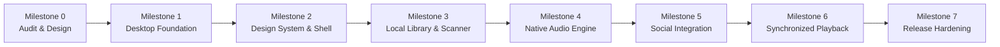

# SyncD Desktop — Master Implementation Plan & Roadmap

## 1. Executive Summary & Delivery Milestones

This document sets the engineering roadmap for building **SyncD Desktop** in small, verifiable, reviewable milestones. Each milestone has strictly defined acceptance criteria, verification scripts, and reporting requirements.

---

## 2. Milestone Breakdown & Verification Gates

### Milestone 0: Audit & Design (CURRENT MILESTONE)
- **Goal:** Complete comprehensive repository audit, verify existing backend contracts, evaluate T3 Code design reference, produce full architecture documentation suite, migrate CI workflows, and establish root git hygiene.
- **Deliverables:**
  - `Desktop/docs/ARCHITECTURE.md`
  - `Desktop/docs/API_INTEGRATION.md`
  - `Desktop/docs/PLAYBACK_ARCHITECTURE.md`
  - `Desktop/docs/UI_UX_SPECIFICATION.md`
  - `Desktop/docs/STATE_AND_ERROR_HANDLING.md`
  - `Desktop/docs/SECURITY.md`
  - `Desktop/docs/TECHNICAL_DECISIONS.md`
  - `Desktop/docs/IMPLEMENTATION_PLAN.md`
  - Root `.gitignore`, `.github/workflows/web-ci.yml`, and `.github/workflows/desktop-ci.yml`.
- **Exit Gate:** All documents complete, verified against existing backend source code, approved by human engineer.

---

### Milestone 1: Desktop Foundation
- **Goal:** Initialize Tauri 2 project inside `Desktop/` with React 19, TypeScript (strict), Vite, Tailwind CSS v4, SQLite database pool, versioned migrations, and typed IPC bridge.
- **Tasks:**
  - `M1-T1`: Initialize `Desktop/` project with Tauri 2 and Vite template.
  - `M1-T2`: Configure strict TypeScript, ESLint, and Tailwind CSS v4 design tokens.
  - `M1-T3`: Implement Rust application state and initialize SQLite database with WAL mode in `%USERPROFILE%\Desktop\SyncD\Index\library.db`.
  - `M1-T4`: Apply initial database migration (`001_initial_schema.sql`).
  - `M1-T5`: Establish typed bidirectional IPC bridge (`commands/` and `events/`).
  - `M1-T6`: Configure restrictive Tauri 2 capabilities in `src-tauri/capabilities/default.json`.
- **Verification Gate:** `cargo check`, `cargo test`, `npm run typecheck`, `npm run build`, and clean desktop window launch.

---

### Milestone 2: Design System & UI Shell
- **Goal:** Build the complete desktop application shell inspired by T3 Code (`pingdotgg/t3code`), including custom titlebar, resizable 3-column layout, persistent bottom player bar, accessible UI primitives, and full state feedback components.
- **Tasks:**
  - `M2-T1`: Implement custom frameless titlebar with window controls (minimize, maximize, close) and global search trigger (`Ctrl+K`).
  - `M2-T2`: Implement 3-column desktop shell (collapsible left sidebar, center view router, collapsible right drawer).
  - `M2-T3`: Create reusable UI primitives: `Button`, `Input`, `SearchInput`, `ContextMenu`, `Modal`, `Tooltip`, `Card`.
  - `M2-T4`: Create persistent bottom player bar component with seek scrubber, volume control, and playback status indicators.
  - `M2-T5`: Implement global state feedback primitives: `LoadingState`, `EmptyState`, `ErrorState`, `OfflineBanner`, `InlineError`, `ConfirmDialog`.
  - `M2-T6`: Implement screen shells for `Home`, `Library`, `Playlists`, `Rooms`, and `Settings`.
- **Verification Gate:** Visual inspection, keyboard navigation tests (`Tab`, `Space`, `Ctrl+1..4`), component state tests.

---

### Milestone 3: Local Library & Scanner
- **Goal:** Implement high-throughput background directory indexing, Lofty audio tag extraction, lazy album cover extraction, and SQLite FTS5 search.
- **Tasks:**
  - `M3-T1`: Implement native folder selection dialog and persistence in SQLite `indexed_folders` table.
  - `M3-T2`: Implement recursive directory scanner with bounded `rayon` worker pool.
  - `M3-T3`: Integrate `lofty` metadata extractor (Title, Artist, Album, Year, Genre, Track Number, Duration, Bitrate).
  - `M3-T4`: Implement lazy embedded artwork extraction and disk caching to `%USERPROFILE%\Desktop\SyncD\Data\artwork\`.
  - `M3-T5`: Implement SQLite FTS5 search index and search IPC command (`search_library`).
  - `M3-T6`: Connect virtualized track table (`TrackTable.tsx`) with search, sort, and filter capabilities.
  - `M3-T7`: Implement missing file and disconnected drive detection.
- **Verification Gate:** Scan 10,000+ files under test benchmark; sub-15ms FTS5 search queries; verify zero UI freezing during scan.

---

### Milestone 4: Native Playback Engine
- **Goal:** Implement the Rust audio engine using Symphonia (decoding) and CPAL (WASAPI output) with bounded streaming ring buffer, sub-30ms seeking, and Windows SMTC media keys.
- **Tasks:**
  - `M4-T1`: Implement CPAL audio device output stream manager with automatic default device selection.
  - `M4-T2`: Implement Symphonia decoder worker thread streaming into `rtrb` lock-free ring buffer.
  - `M4-T3`: Implement precision seek algorithm with keyframe alignment and silence padding.
  - `M4-T4`: Implement atomic volume scaling with logarithmic perceptual curve.
  - `M4-T5`: Implement 10Hz playhead event emitter from native core to React Zustand player store.
  - `M4-T6`: Implement local playlist & queue management (shuffle, repeat, auto-advance).
  - `M4-T7`: Integrate Windows SMTC (System Media Transport Controls) and hardware media keys (`VK_MEDIA_*`).
- **Verification Gate:** Stable playback across MP3, FLAC, WAV, AAC, Vorbis; 0 audio buffer underruns during screen navigation; media keys functional.

---

### Milestone 5: Social Integration
- **Goal:** Connect SyncD Desktop to the existing SyncD Node.js/PostgreSQL backend with Clerk authentication, REST client, and Socket.IO real-time events.
- **Tasks:**
  - `M5-T1`: Implement secure desktop OAuth PKCE login flow and store credentials in Windows Credential Manager via `keyring`.
  - `M5-T2`: Implement typed REST API client for `/api/me`, `/api/users/profile`, and `/api/rooms/*`.
  - `M5-T3`: Implement Socket.IO client with WebSocket-only transport, Bearer token auth, and auto-reconnection.
  - `M5-T4`: Implement Room join/leave lifecycle, live member presence rendering, and host status display.
  - `M5-T5`: Implement real-time room chat with optimistic delivery and failed-message retry.
  - `M5-T6`: Implement shared room queue (host mutations: add, prepend, remove, reorder, clear, advance).
  - `M5-T7`: Implement 30-second host transfer countdown banner and manual host transfer action.
- **Verification Gate:** Connect desktop client to live local backend server; verify simultaneous presence and chat alongside Web client.

---

### Milestone 6: Synchronized Playback
- **Goal:** Implement shared local-track playback, authoritative room timeline reconciliation, and bounded drift correction.
- **Tasks:**
  - `M6-T1`: Implement local track resolver matching room track (`videoId`, `title`, `artist`, `duration`) against local SQLite index.
  - `M6-T2`: Implement explicit `MissingLocalTrack` UI indicator when no local match exists.
  - `M6-T3`: Implement timestamp-based playhead derivation engine:
    $$\text{Expected} = \text{playback.position} + \frac{\text{serverTime} - \text{updatedAt}}{1000}$$
  - `M6-T4`: Implement bounded drift reconciler (reseeks if $|\Delta| > 2.0\text{s}$, smooth otherwise).
  - `M6-T5`: Implement echo suppression window (2,000ms) after applying remote snapshot.
  - `M6-T6`: Execute automated cross-client integration tests (Desktop Host + Web Participant, Web Host + Desktop Participant).
- **Verification Gate:** Automated multi-client test verifying drift stays $< 2.0\text{s}$ over 10 minutes of synchronized playback.

---

### Milestone 7: Release Hardening & Windows Distribution
- **Goal:** Build the production NSIS Windows installer, configure upgrade preservation, run security and performance audits, and finalize CI.
- **Tasks:**
  - `M7-T1`: Configure Tauri NSIS installer for Windows, ensuring `%USERPROFILE%\Desktop\SyncD\` data persists across uninstalls and updates.
  - `M7-T2`: Benchmark 10k, 50k, and 100k track indexing, memory footprint, and startup time.
  - `M7-T3`: Run security audit: check Tauri capabilities, path canonicalization, and secret redaction in logs.
  - `M7-T4`: Verify Desktop CI workflow (`.github/workflows/desktop-ci.yml`) and Web CI workflow (`.github/workflows/web-ci.yml`).
- **Verification Gate:** Clean install on fresh Windows machine; zero regressions in Web CI.

---

## 3. Detailed Task Format Matrix (Milestones 1-7)

| Task ID | Component | Agent | Skills | Priority | Dependencies | Verify Command |
|---|---|---|---|---|---|---|
| `M1-T1` | Tauri Shell | `orchestrator` | `rust-pro`, `clean-code` | P0 | M0 | `cargo tauri info` |
| `M1-T2` | Frontend Build | `frontend-specialist` | `react-best-practices`, `tailwind-patterns` | P0 | M1-T1 | `npm run build` |
| `M1-T3` | SQLite DB | `database-architect` | `database-design` | P0 | M1-T1 | `cargo test db` |
| `M2-T1` | UI Shell | `frontend-specialist` | `frontend-design` | P1 | M1-T2 | `npm run test:ui` |
| `M3-T2` | Scanner | `backend-specialist` | `rust-pro` | P1 | M1-T3 | `cargo test scanner` |
| `M4-T2` | Audio Engine | `backend-specialist` | `rust-pro` | P1 | M1-T1 | `cargo test audio` |
| `M5-T3` | Socket.IO | `backend-specialist` | `api-patterns` | P1 | M2-T1 | `npm run test:socket` |
| `M6-T4` | Drift Sync | `test-engineer` | `testing-patterns` | P1 | M4-T2, M5-T3 | `npm run test:sync` |
| `M7-T1` | NSIS Build | `devops-engineer` | `deployment-procedures` | P2 | M1-M6 | `cargo tauri build` |

