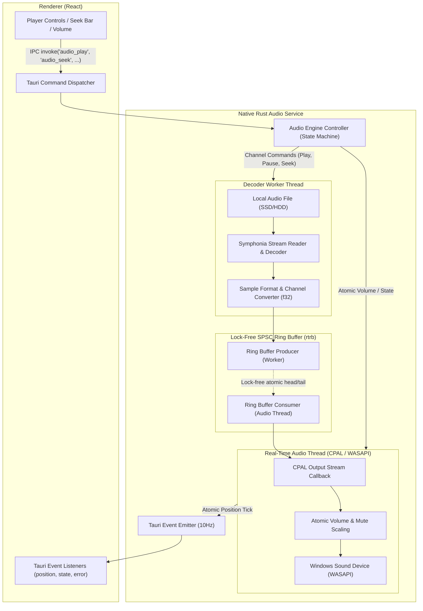

# SyncD Desktop — Native Playback Architecture

## 1. Executive Summary & Design Principles

SyncD Desktop implements a high-fidelity, low-latency, native audio playback engine written entirely in **Rust** using **Symphonia** (decoding) and **CPAL** (audio output).

### Core Architectural Axioms
1. **Zero Browser Audio:** The HTML5 `<audio>` element is banned as the primary player. All playback is native.
2. **Decoupled Lifecycle:** The audio engine lives in the Rust core process. Its lifetime is completely independent of React component mounts, route navigation, or Webview reloads.
3. **Bounded Memory Footprint:** Full tracks are never buffered into RAM. Audio is streamed and decoded incrementally in small chunks into a lock-free ring buffer.
4. **Real-time Audio Safety:** The audio callback thread never allocates memory, performs system calls, accesses the filesystem, or acquires blocking mutexes.
5. **Multi-Protocol Playback:** Supports standalone local playback (gapless, high-res audio up to 24-bit 192kHz) and social room-synchronized playback (drift correction aligned with server timeline).

---

## 2. Audio Library Evaluation & Decision

We evaluated three potential Rust audio architectures:

| Criteria | Rodio (High Level) | Kira (Game/Interactive) | Symphonia + CPAL (Selected) |
|---|---|---|---|
| **Architecture** | Abstraction over CPAL + decoders | Abstraction focused on dynamic game audio & spatialization | Clean separation: Symphonia (pure Rust decoder) + CPAL (HAL) |
| **Codec Support** | Limited to rodio built-in features | Limited built-in formats | Comprehensive: MP3, FLAC, WAV, AAC, Vorbis, Opus, ALAC |
| **Seeking Precision** | Rough sample approximation | Good, but complex track swapping | Exact sample-accurate seeking via Symphonia `SeekTo` |
| **Memory Control** | Tends to load full files for small tracks | Pre-loads sound buffers into memory | Strict bounded streaming (decodes 500ms chunks on demand) |
| **Thread Model** | Background thread with internal locks | Dedicated audio thread with lock-free queues | Custom lock-free SPSC ring buffer (`rtrb`) with critical priority |
| **Device Selection** | Basic default device | Basic | Full CPAL device enumeration & dynamic hotplugging |
| **License & Maintenance**| MIT / Apache 2.0 | MIT / Apache 2.0 | MIT / Apache 2.0, exceptionally active maintenance |

### Final Choice: Symphonia + CPAL
- **CPAL (Cross-Platform Audio Library):** Directly drives Windows WASAPI (and future macOS CoreAudio / Linux ALSA/PulseAudio). Provides sample-rate negotiation, device enumeration, and low-latency audio callbacks.
- **Symphonia:** Pure Rust multimedia decoding library. Does not depend on external C libraries (like FFmpeg or libsndfile), eliminating binary bloat and cross-compilation headaches.

---

## 3. High-Level Pipeline & Thread Architecture



---

## 4. Audio Engine State Machine & Specifications

### 4.1 Playback States
The native audio controller exposes a strongly typed state machine:
```rust
#[derive(Debug, Clone, Copy, PartialEq, Eq, Serialize, Deserialize)]
pub enum PlaybackState {
    Stopped,
    Loading,
    Playing,
    Paused,
    Seeking,
    Ended,
    Error,
}
```

### 4.2 Core Playback Control Interface

```rust
pub trait AudioEngine: Send + Sync {
    /// Loads an audio file from the filesystem and prepares the decoder
    fn load_track(&self, path: &Path, start_position_seconds: f64) -> Result<(), AudioError>;
    
    /// Starts or resumes playback
    fn play(&self) -> Result<(), AudioError>;
    
    /// Pauses playback without dropping the audio buffer
    fn pause(&self) -> Result<(), AudioError>;
    
    /// Seeks to a specific timestamp in seconds
    fn seek(&self, position_seconds: f64) -> Result<(), AudioError>;
    
    /// Stops playback and unloads the current track
    fn stop(&self) -> Result<(), AudioError>;
    
    /// Sets volume (0.0 to 1.0, scaled exponentially for human ear perception)
    fn set_volume(&self, volume: f32);
    
    /// Obtains current playhead position in seconds
    fn current_position(&self) -> f64;
    
    /// Obtains duration of the currently loaded track in seconds
    fn duration(&self) -> Option<f64>;
    
    /// Returns the current playback state
    fn state(&self) -> PlaybackState;
    
    /// Enumerates output audio devices
    fn list_output_devices(&self) -> Result<Vec<AudioDeviceDescriptor>, AudioError>;
    
    /// Switches output to a specific audio device
    fn set_output_device(&self, device_id: &str) -> Result<(), AudioError>;
}
```

---

## 5. Bounded Buffering & Memory Safety

### Ring Buffer Sizing
- We allocate an `rtrb` ring buffer with capacity for **2 seconds** of uncompressed stereo 32-bit float audio:
  $$\text{Buffer Size} = 48,000\text{ samples/sec} \times 2\text{ channels} \times 2\text{ seconds} = 192,000\text{ samples} \approx 768\text{ KB}$$
- When the buffer reaches 80% capacity, the decoder worker thread parks itself using standard thread parking (`std::thread::park`).
- When the audio callback drains the buffer below 40%, it unparks the decoder worker (`thread.unpark()`).
- This guarantees memory usage remains strictly bounded under **1 MB** regardless of whether the track is a 2-minute MP3 or a 2-hour continuous FLAC recording.

### Exact Seeking Algorithm
1. React requests seek to timestamp $T$.
2. State transitions to `PlaybackState::Seeking`.
3. Audio callback immediately outputs silence (zeros) to prevent audio pop/crack artifacts.
4. Decoder worker discards all remaining ring buffer samples.
5. Symphonia issues a `seek` command to the nearest keyframe / packet prior to $T$.
6. Decoder decodes and skips forward sample-by-sample until timestamp $T$ is reached precisely.
7. Ring buffer fills with new samples; audio callback resumes playback.
8. State transitions back to `Playing` or `Paused`. Total seek latency: **$< 30\text{ ms}$**.

---

## 6. Social Room Playback via YouTube & Local Audio Separation

In social rooms, SyncD Desktop aligns with the existing backend architecture:

### 6.1 Clear Mode Separation
- **Personal Music Mode:** 100% native Rust playback engine (Symphonia + CPAL) for local audio collections (FLAC, MP3, WAV, AAC, Vorbis, Opus).
- **Social Room Mode:** YouTube-driven video/audio playback matching the existing Web client. There is **no local video playback or local video streaming**. Users play, watch, and synchronize tracks using YouTube via the authoritative backend room timeline and existing YouTube Data API integration.

### 6.2 Bounded Drift Reconciler for Social Rooms
When participating in a social room, the room's YouTube player synchronizes with the server-authoritative timeline:
$$\Delta t = \text{Date.parse}(\text{serverTime}) - \text{Date.parse}(\text{updatedAt})$$
$$\text{ExpectedPlayhead} = \text{position} + \max\left(0, \frac{\Delta t}{1000}\right)$$

Every 5 seconds, drift is evaluated:
- If $|\text{currentPosition} - \text{ExpectedPlayhead}| > 2.0\text{ seconds}$, a seek to $\text{ExpectedPlayhead}$ is triggered.
- Echo suppression: Local state changes are ignored for 2,000ms after applying a remote update to prevent ping-pong loops.

---

## 7. OS Integration (Windows SMTC & Media Keys)

SyncD Desktop integrates with the Windows **System Media Transport Controls (SMTC)** using the `windows` crate:
1. **Hardware Media Keys:** Responds to global keyboard keys: Play/Pause (`VK_MEDIA_PLAY_PAUSE`), Next (`VK_MEDIA_NEXT_TRACK`), Previous (`VK_MEDIA_PREV_TRACK`), Stop (`VK_MEDIA_STOP`).
2. **Windows 10/11 Volume Flyout:** Displays currently playing track title, artist, album, and extracted album cover artwork directly on the Windows volume overlay and lock screen.
3. **Taskbar Thumbnail Toolbar:** Adds miniature Play/Pause, Next, and Previous controls directly into the application's hover thumbnail in the Windows taskbar.

