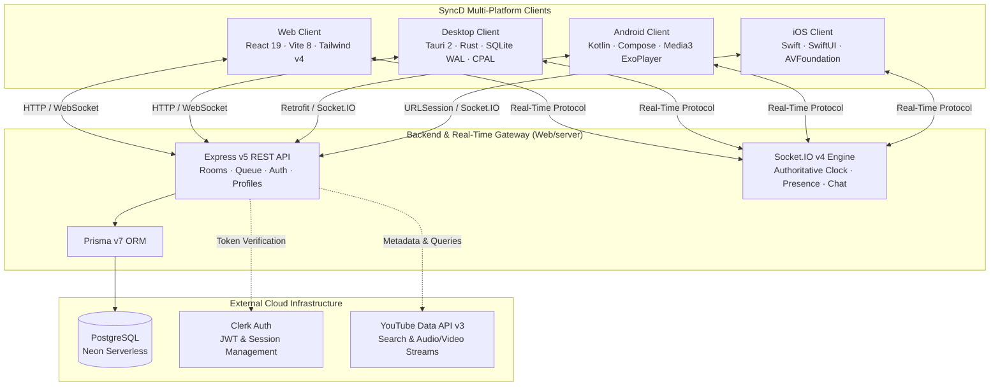
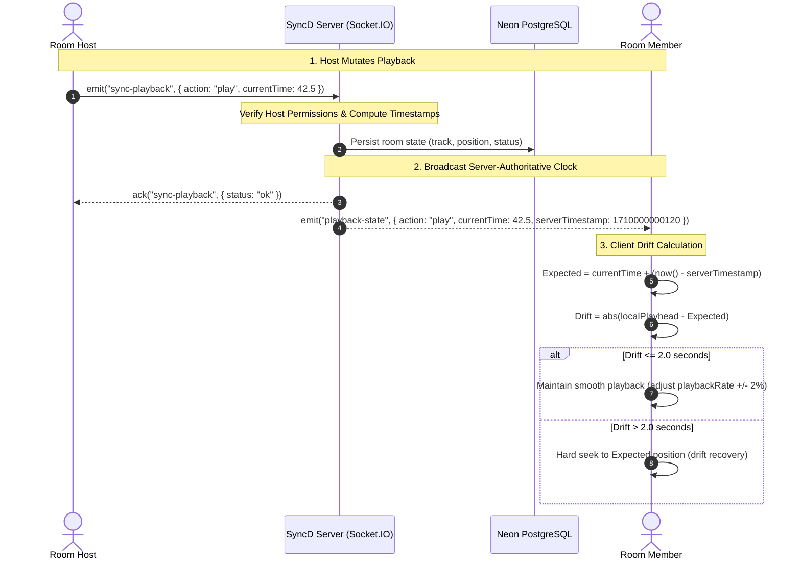

# SyncD - Cross-Platform Synchronized Music & Social Listening Ecosystem

<div align="center">


### *The Real-Time Social Music-Listening Sanctuary & Synchronized Media Lounge*

[](./Desktop)
[](./Web/client)
[](./Mobile/Android)
[](./Mobile/Ios)
[](./Web/server)
[](LICENSE)

<br/>

<table align="center" width="100%">
  <tr>
    <td align="center" width="20%">
      <b>Authoritative Sync</b><br/>
      <sub>Dynamic drift recovery &lt; 2.0s</sub>
    </td>
    <td align="center" width="20%">
      <b>Host Governance</b><br/>
      <sub>Strict role-gated mutations</sub>
    </td>
    <td align="center" width="20%">
      <b>Sub-30ms Audio</b><br/>
      <sub>Native CPAL WASAPI playback</sub>
    </td>
    <td align="center" width="20%">
      <b>Lossless Linkage</b><br/>
      <sub>Local track auto-substitution</sub>
    </td>
    <td align="center" width="20%">
      <b>Cross-Platform</b><br/>
      <sub>Web · Desktop · Android · iOS</sub>
    </td>
  </tr>
</table>

<p align="center">
  <a href="#ecosystem-overview">Overview</a> &nbsp;•&nbsp;
  <a href="#system-architecture">Architecture</a> &nbsp;•&nbsp;
  <a href="#platform-matrix">Platform Matrix</a> &nbsp;•&nbsp;
  <a href="#synchronization-protocol">Sync Protocol</a> &nbsp;•&nbsp;
  <a href="#monorepo-layout">Monorepo Layout</a> &nbsp;•&nbsp;
  <a href="#prerequisites--quick-start">Quick Start</a> &nbsp;•&nbsp;
  <a href="#continuous-integration">CI/CD</a>
</p>

---

</div>

<br/>

## Ecosystem Overview

**SyncD** is a multi-platform social music-listening ecosystem engineered for group synchronization, high-fidelity playback, and real-time community engagement. Rather than forcing users to rely on screen shares, lossy voice channels, or desynchronized browser tabs, SyncD connects clients over a lightweight, server-authoritative protocol that keeps audio and video aligned across all devices.

The repository houses four primary applications alongside shared design and audio assets:

1. **[Web Application (`Web/`)](./Web/README.md):** Cloud-deployed web client and authoritative backend service delivering server-side room management, PostgreSQL persistence, and browser playback.
2. **[Desktop Application (`Desktop/`)](./desktop-architecture.md):** Native Windows and cross-platform desktop player powered by Tauri 2 and Rust, featuring sub-30ms seek latency, zero-allocation CPAL WASAPI playback, Lofty metadata scanning, SQLite WAL + FTS5 indexing, and YouTube room sync with local lossless track linkage.
3. **[Android Native App (`Mobile/Android/`)](./Mobile/Android/SyncD_Android_README.md):** Jetpack Compose and AndroidX Media3 (ExoPlayer) native mobile client with background playback services, lock-screen media controls, and real-time room presence.
4. **[iOS Native App (`Mobile/Ios/`)](./Mobile/Ios/SyncD_iOS_README.md):** Swift and SwiftUI native mobile client featuring AVFoundation media engines, Control Center / Now Playing lock-screen integration, and low-latency Socket.IO room coordination.
5. **[Sound Design Engine (`Audio/`)](./Audio/):** Modular library of handcrafted UI audio cues and spatial feedback events (room joins, scans, notifications, drawer animations, and toggles).

---

## System Architecture

### Multi-Client Topology

The SyncD ecosystem unifies native desktop, mobile, and web applications under an authoritative Node.js/Socket.IO backend with PostgreSQL persistence and Clerk identity integration:



---

## Platform Matrix

| Platform | Location | Primary Tech Stack | Audio / Playback Engine | Storage / State |
| :--- | :--- | :--- | :--- | :--- |
| **Backend Server** | [`Web/server/`](./Web/server) | Node.js 20+, Express 5, Socket.IO 4, TypeScript | Server-Authoritative Clock | PostgreSQL (Neon), Prisma 7 |
| **Web Client** | [`Web/client/`](./Web/client) | React 19, TypeScript, Vite 8, Tailwind CSS 4 | YouTube IFrame API | Web Audio API, React Router 7 |
| **Desktop Client** | [`Desktop/`](./Desktop) | Tauri 2, Rust 1.75+, React 19, Vite 6, Tailwind 4 | Symphonia + CPAL (WASAPI/ASIO) + YouTube Sync | SQLite 3 (WAL + FTS5), Zustand |
| **Android Client** | [`Mobile/Android/`](./Mobile/Android) | Kotlin, Jetpack Compose, Navigation Compose | AndroidX Media3 (ExoPlayer) + MediaSession | Room DB, DataStore, Keystore |
| **iOS Client** | [`Mobile/Ios/`](./Mobile/Ios) | Swift, SwiftUI, Combine | AVFoundation (`AVPlayer` / `AVQueuePlayer`) | Keychain, CoreData / SwiftData |
| **Audio Assets** | [`Audio/`](./Audio) | MP3 Audio Assets (44.1kHz, stereo) | Native sound players across clients | Static filesystem assets |

---

## Synchronization Protocol

All clients observe a **Server-Authoritative Playhead Model** with bounded client-side drift reconciliation:



### Protocol Safeguards
- **Host Governance:** Only verified room hosts can emit state-mutating actions (`play`, `pause`, `seek`, `next-track`).
- **Host Transfer Grace Period:** If the host drops unexpectedly, a 30-second countdown initiates before ownership safely transfers to the next senior room member.
- **Echo Suppression:** When seeking or switching tracks, event listeners ignore feedback echoes for 2,000ms to eliminate thrashing.
- **Lossless Local Linkage (Desktop):** If a social room song matches a verified local lossless audio file (via Lofty tag fingerprinting), SyncD Desktop plays the pristine local stream while preserving millisecond synchronization.

---

## Monorepo Layout

```text
Syncd/
├── .github/
│   └── workflows/
│       ├── web-ci.yml                 # Lint, build & test for Web client & server
│       └── desktop-ci.yml             # Rust clippy, check & frontend build for Desktop
├── Audio/                             # UI sound design assets & event cues
│   ├── Deletion/                      # Action undo & deletion cues
│   ├── Drawer/                        # Drawer open/close audio
│   ├── Notification/                  # Notification & chat ping sounds
│   ├── Room/                          # Room create, join, leave feedback
│   ├── Scan/                          # Library scan outcomes (Success, Fail, Tally)
│   ├── Toggle/                        # Switch & toggle effects
│   └── Update/                        # State update indicators
├── Desktop/                           # Tauri 2 native desktop application
│   ├── docs/                          # 8 Master engineering specifications
│   ├── src/                           # React 19 + TypeScript + Tailwind v4 UI
│   ├── src-tauri/                     # Rust backend (Symphonia, CPAL, Rusqlite, Lofty)
│   ├── package.json                   # Desktop frontend scripts & dependencies
│   └── vite.config.ts                 # Vite 6 configuration for Tauri
├── Mobile/
│   ├── Android/                       # Native Android application
│   │   ├── app/                       # Android application module
│   │   ├── gradle/                    # Gradle wrapper & version catalogs
│   │   ├── build.gradle.kts           # Kotlin DSL root configuration
│   │   └── SyncD_Android_README.md    # Android architecture & setup guide
│   └── Ios/                           # Native iOS application
│       ├── SyncD/                     # Swift / SwiftUI source files
│       ├── SyncD.xcodeproj/           # Xcode project bundle
│       ├── SyncDTests/                # XCTest unit & integration suites
│       └── SyncD_iOS_README.md        # iOS architecture & setup guide
├── Web/                               # Web client & backend service
│   ├── client/                        # React 19 web frontend
│   ├── server/                        # Express 5 + Socket.IO 4 + Prisma backend
│   ├── docs/                          # Web architectural & API documentation
│   └── README.md                      # Comprehensive Web client/server guide
├── desktop-architecture.md            # Master desktop architecture roadmap
└── README.md                          # Root monorepo documentation
```

---

## Prerequisites & Quick Start

### Global Toolchain Prerequisites

| Tool | Version Requirement | Used By |
| :--- | :--- | :--- |
| **Node.js** | `>= 20.0.0` (LTS recommended) | Web, Desktop (Frontend) |
| **npm** | `>= 10.0.0` | Web, Desktop |
| **Rust & Cargo** | `>= 1.75.0` (with MSVC toolchain on Windows) | Desktop (`src-tauri`) |
| **Android Studio** | Hedgehog / Jellyfish or newer (JDK 17+) | Mobile (`Android`) |
| **Xcode** | `>= 15.0` (macOS 14+) | Mobile (`iOS`) |

---

### 1. Web Backend & Client

The backend server must be running to support room discovery, authentication, and WebSocket sync across all platforms.

```bash
# 1. Navigate to server, install dependencies, and setup Prisma
cd Web/server
npm install
cp .env.example .env      # Configure DATABASE_URL, CLERK_SECRET_KEY, etc.
npx prisma generate
npx prisma migrate dev

# 2. Start the development server (runs on http://localhost:5000)
npm run dev

# 3. In a separate terminal, start the Web Client
cd ../client
npm install
cp .env.example .env      # Configure VITE_CLERK_PUBLISHABLE_KEY, etc.
npm run dev               # Runs on http://localhost:5173
```

*For complete details, see [`Web/README.md`](./Web/README.md).*

---

### 2. Desktop Application (Tauri 2 + Rust)

```bash
cd Desktop

# 1. Install frontend dependencies
npm install

# 2. Run Desktop app in Tauri development mode
npm run tauri dev
```

*For building production native binaries:*
```bash
npm run tauri build
```
*For complete architecture specs, see [`desktop-architecture.md`](./desktop-architecture.md) and [`Desktop/docs/`](./Desktop/docs).*

---

### 3. Native Android Client

1. Open **Android Studio**.
2. Select **Open** and choose the `Mobile/Android` directory.
3. Allow Gradle to synchronize dependencies.
4. Copy `syncd.local.properties.example` to `local.properties` (or configure your SDK location).
5. Build and launch on an Android Virtual Device (API 34+) or physical device:
   ```bash
   cd Mobile/Android
   ./gradlew assembleDebug
   ```

*For complete details, see [`Mobile/Android/SyncD_Android_README.md`](./Mobile/Android/SyncD_Android_README.md).*

---

### 4. Native iOS Client

1. Open **Xcode** on macOS.
2. Open `Mobile/Ios/SyncD.xcodeproj`.
3. Configure your Development Team in **Signing & Capabilities**.
4. Select an iOS Simulator (iOS 17+) or connected iPhone and run (`Cmd + R`).

*For complete details, see [`Mobile/Ios/SyncD_iOS_README.md`](./Mobile/Ios/SyncD_iOS_README.md).*

---

## Continuous Integration

The repository uses GitHub Actions workflows with path-based triggers to ensure optimal test runtimes:

| Workflow | Path Triggers | Actions Executed |
| :--- | :--- | :--- |
| **[Web CI](.github/workflows/web-ci.yml)** | `Web/**` | Type checking, ESLint linting, Prisma schema validation, Vitest test execution |
| **[Desktop CI](.github/workflows/desktop-ci.yml)** | `Desktop/**` | Rust `cargo check`, `cargo clippy`, frontend TypeScript verification & Vite build |

To run local verification before submitting changes:
```bash
# Verify Web Server
cd Web/server && npm run typecheck && npm test

# Verify Desktop
cd Desktop && npm run typecheck && cargo check --manifest-path src-tauri/Cargo.toml
```

---

## Security & Architecture Standards

- **Strict Separation of Concerns:** UI rendering, audio playback pipelines, network transports, and local caching layers operate in isolated modules.
- **Server Authority:** Playhead position, host promotion, and room queue mutations are strictly validated on the backend.
- **Dedicated Design Tokens:** Desktop and native platforms strictly conform to curated design token palettes without uncurated color drifts.
- **Zero In-Tree Secrets:** All API keys, database credentials, and Clerk secrets are managed via local `.env` files and environment stores excluded from version control.

---

## License & Governance

Individual sub-projects in this repository are licensed as follows:
- **SyncD Desktop & Mobile:** [MIT License](LICENSE)
- **SyncD Web Client & Server:** [ISC License](./Web/server/package.json)

---

<div align="center">
<sub>Crafted with passion for audiophiles, social listeners, and cross-platform native engineering.</sub>
</div>
