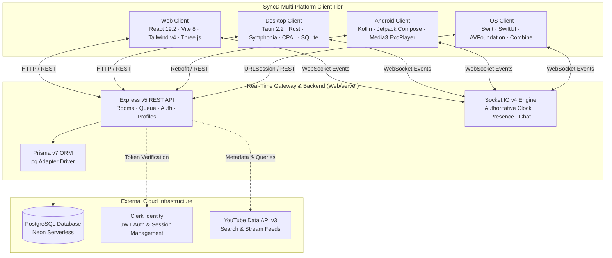
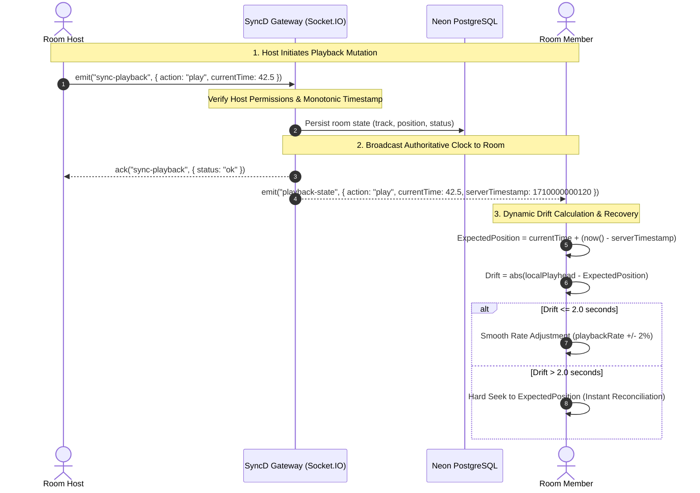

# SyncD - Cross-Platform Synchronized Music & Social Listening Ecosystem

<div align="center">


### *The Real-Time Social Music-Listening Sanctuary & Synchronized Media Lounge*

[](./Desktop)
[](./Web/client)
[](./Mobile/Android)
[](./Mobile/Ios)
[](./Web/server)
[](https://www.prisma.io/)

<br/>

<table align="center" width="100%">
  <tr>
    <td align="center" width="20%">
      <b>Authoritative Sync</b><br/>
      <sub>Server playhead with &lt; 2.0s drift recovery</sub>
    </td>
    <td align="center" width="20%">
      <b>Sub-30ms Audio</b><br/>
      <sub>Lock-free CPAL WASAPI playback pipeline</sub>
    </td>
    <td align="center" width="20%">
      <b>Host Governance</b><br/>
      <sub>Role-gated mutations &amp; 30s handover</sub>
    </td>
    <td align="center" width="20%">
      <b>Lossless Linkage</b><br/>
      <sub>Local track Lofty metadata substitution</sub>
    </td>
    <td align="center" width="20%">
      <b>Cinematic Ambience</b><br/>
      <sub>Warm sunset palette &amp; spatial UI cues</sub>
    </td>
  </tr>
</table>

<p align="center">
  <a href="#-ecosystem-overview">Ecosystem Overview</a> &nbsp;•&nbsp;
  <a href="#-platform-showcase">Platform Showcase</a> &nbsp;•&nbsp;
  <a href="#-multi-client-architecture">Architecture</a> &nbsp;•&nbsp;
  <a href="#-synchronization-protocol">Sync Protocol</a> &nbsp;•&nbsp;
  <a href="#-platform-matrix">Platform Matrix</a> &nbsp;•&nbsp;
  <a href="#-monorepo-layout">Monorepo Layout</a> &nbsp;•&nbsp;
  <a href="#-prerequisites--quick-start">Quick Start</a> &nbsp;•&nbsp;
  <a href="#-ci-and-quality-gates">CI / Quality</a>
</p>

---

</div>

<br/>

## 🧭 Ecosystem Overview

**SyncD** is a multi-platform social music-listening sanctuary engineered for group synchronization, high-fidelity playback, and real-time community engagement. Rather than forcing users to rely on clunky screen shares, lossy voice channels, or desynchronized browser tabs, SyncD connects clients over a lightweight, **server-authoritative protocol** that keeps music, videos, and playback states harmonized down to the millisecond across desktop, mobile, and web.

### Core Architectural Pillars
- **Server-Authoritative Clock:** The server maintains true playhead time and broadcasts synchronized states. Clients gently reconcile drift under 2 seconds (+/- 2% pitch bending) and hard seek only when exceeding the drift boundary.
- **True Cross-Platform Native Stacks:** No compromised web-view wrappers for mobile or desktop. Desktop is powered by **Tauri 2 + Rust + CPAL**, Android by **Kotlin + Jetpack Compose + Media3**, and iOS by **Swift + SwiftUI + AVFoundation**.
- **Host-Guarded Governance with Grace Handover:** Room hosts hold exclusive rights to seek, skip, and pause. If a host disconnects, a 30-second countdown protects the room before transferring ownership seamlessly to the next senior member.
- **Lossless Local Linkage:** SyncD Desktop inspects local lossless audio libraries (FLAC, ALAC, WAV) using Lofty tag indexing; when a room plays a track matching your local collection, the native engine substitutes pristine local audio while staying locked to the group playhead.

---

## 🎛️ Platform Showcase

SyncD distributes its capabilities across dedicated native and web frontends powered by a high-performance real-time gateway:

<table>
<tr>
<td width="50%" valign="top">

### 🖥️ Desktop Application (`Desktop/`)
*Built with Tauri 2.2, Rust 1.75+, React 19, and Tailwind CSS v4*

- **Native Audio Pipeline:** Sub-30ms seek latency via Symphonia decoders, lock-free RTRB ring buffers, and CPAL (WASAPI/ASIO) low-level stream playback.
- **Local Library Indexing:** Blazing-fast parallel filesystem crawler powered by Rayon, Lofty tag extraction, and SQLite 3 (WAL mode + FTS5 full-text search).
- **Lossless Audio Substitution:** Replaces cloud audio streams with matching local lossless files dynamically while preserving millisecond room sync.
- **Fluid Desktop UX:** Powered by Zustand 5 state orchestration, GSAP physics, Lucide & Hugeicons, and native OS windowing.
- 📖 **Deep Dive:** [Desktop Architecture Spec](./Desktop/docs/ARCHITECTURE.md) • [Playback Engine Spec](./Desktop/docs/PLAYBACK_ARCHITECTURE.md)

</td>
<td width="50%" valign="top">

### 🌐 Web Client & Server Gateway (`Web/`)
*Built with React 19.2, Vite 8, Express 5, Socket.IO 4, and Prisma 7*

- **Cinematic Web Lounge:** Ambient WebGL sunset wave line shaders (Three.js), magnetic spring buttons, vinyl turntable graphics, and reactive equalizer animations.
- **Authoritative Gateway:** Express 5 REST API + Socket.IO v4 real-time server handling room state, user presence, chat, and monotonic clock synchronization.
- **Identity & Persistence:** Clerk JWT authentication, PostgreSQL hosted on Neon Serverless, and Prisma 7 with native pg adapter pooling.
- **YouTube Media Streaming:** Compliant YouTube IFrame API integration with adaptive synchronization and drift suppression.
- 📖 **Deep Dive:** [Web Documentation](./Web/README.md) • [Web Architecture](./Web/docs/ARCHITECTURE.md)

</td>
</tr>
<tr>
<td width="50%" valign="top">

### 🤖 Android Native Client (`Mobile/Android/`)
*Built with Kotlin, Jetpack Compose, and AndroidX Media3 (ExoPlayer)*

- **Media3 Playback Service:** Long-running `MediaSessionService` powering background audio playback, system media notifications, and lock-screen controls.
- **Modern Android Architecture:** Declarative Jetpack Compose UI, Navigation Compose, unidirectional data flow (ViewModel + StateFlow), and Android Keystore security.
- **Real-Time Room Presence:** Low-overhead Socket.IO client keeping room chat, member roster, and playhead strictly synchronized with the gateway.
- **Audio Routing & Focus:** Intelligent handling of headset connects, Bluetooth routing, audio interruptions, and transient network drops.
- 📖 **Deep Dive:** [Android Native Guide](./Mobile/Android/SyncD_Android_README.md)

</td>
<td width="50%" valign="top">

### 🍏 iOS Native Client (`Mobile/Ios/`)
*Built with Swift, SwiftUI, Combine, and AVFoundation*

- **Native Apple Audio Engine:** `AVPlayer` and `AVQueuePlayer` playback integration supporting authorized remote audio streams and local playback.
- **System Media Integration:** Complete lock-screen Now Playing metadata, Control Center controls, and MPRemoteCommandCenter hardware integration.
- **SwiftUI Componentry:** Floating persistent mini-player, full-screen interactive queue, fluid sheet transitions, and real-time room chat.
- **Robust Session Handling:** Automatic token refresh, Keychain-backed credential storage, and Combine-driven reactive state feeds.
- 📖 **Deep Dive:** [iOS Native Guide](./Mobile/Ios/SyncD_iOS_README.md)

</td>
</tr>
</table>

### 🔊 Sound Design & Spatial Audio Engine (`Audio/`)
A modular library of handcrafted 44.1kHz stereo UI sound cues providing tactile auditory feedback across all clients:
- **Room Feedback:** Ambient cues for room creation, joining, and leaving (`Audio/Room/`).
- **Library Scanning:** Distinct feedback for successful file indexation, scan errors, and tally increments (`Audio/Scan/`).
- **Interactive UI:** Micro-cues for drawer slides, switch toggles, updates, and undo deletions (`Audio/Drawer/`, `Audio/Toggle/`, `Audio/Deletion/`, `Audio/Notification/`).

---

## 🏛️ Multi-Client Architecture

The SyncD ecosystem unifies desktop, mobile, and web applications under a single authoritative Node.js/Socket.IO backend with PostgreSQL persistence and Clerk identity integration:



---

## ⚡ Synchronization Protocol

All clients adhere to a **Server-Authoritative Monotonic Clock Model** designed to prevent playback thrashing and eliminate echo loops:



### Protocol Safeguards
1. **Strict Host Role Gating:** Mutations (`play`, `pause`, `seek`, `next-track`) are authenticated on the backend against the active host ID before any state change is acknowledged.
2. **30-Second Host Grace Period:** If the host drops due to network interruptions, a 30-second reservation timer holds room ownership before automatically promoting the next most senior participant.
3. **2,000ms Echo Suppression:** Client audio listeners mute incoming loopback events for 2,000ms post-seek to eliminate audio flutter and desync cascades.
4. **Lossless Local Substitution:** SyncD Desktop matches incoming YouTube song signatures against locally stored lossless audio (using Lofty tags); if found, it plays pristine local FLAC/WAV audio while remaining locked to the server playhead.

---

## 📊 Platform Matrix

| Capability / Attribute | Web Client | Desktop (Tauri 2) | Android Native | iOS Native | Backend Server |
| :--- | :---: | :---: | :---: | :---: | :---: |
| **Directory** | [`Web/client/`](./Web/client) | [`Desktop/`](./Desktop) | [`Mobile/Android/`](./Mobile/Android) | [`Mobile/Ios/`](./Mobile/Ios) | [`Web/server/`](./Web/server) |
| **Language / Framework** | React 19.2, Vite 8, TS 6 | Rust 1.75+, React 19, TS 5.7 | Kotlin, Jetpack Compose | Swift, SwiftUI, Combine | Node 20+, Express 5, TS |
| **Styling / Design System** | Tailwind CSS v4.3 | Tailwind CSS v4.0, GSAP | Compose Material 3 Tokens | SwiftUI Design System | — |
| **Audio Playback Engine** | YouTube IFrame API | Symphonia + CPAL (WASAPI/ASIO) | AndroidX Media3 (ExoPlayer) | AVFoundation (`AVPlayer`) | Monotonic Server Clock |
| **Sub-30ms Seek Latency** | ❌ (Browser Web Audio) | ✅ (Lock-free Ring Buffer) | ⚠️ (~50ms ExoPlayer) | ⚠️ (~50ms AVPlayer) | N/A |
| **Local File Indexing** | ❌ (Sandboxed) | ✅ (SQLite FTS5 + Rayon) | ⚠️ (Device MediaStore) | ⚠️ (App Document Sandbox) | — |
| **Lossless Substitution** | ❌ | ✅ (Lofty Tag Match) | 🔄 (Roadmap) | 🔄 (Roadmap) | — |
| **Background Playback** | ❌ (Browser Tab Only) | ✅ (Window Minimize) | ✅ (`MediaSessionService`) | ✅ (`AVAudioSession` Background) | N/A |
| **System Media Controls** | ⚠️ (Media Session API) | ✅ (OS Media Hook) | ✅ (Notification & Lockscreen) | ✅ (Now Playing & Control Center)| N/A |
| **Storage / Caching** | LocalStorage / IndexedDB | SQLite 3 (WAL + FTS5) | Room DB + DataStore | CoreData / SwiftData + Keychain | PostgreSQL (Neon) + Prisma 7 |

---

## 📂 Monorepo Layout

```text
Syncd/
├── .github/
│   └── workflows/
│       ├── web-ci.yml                 # Lint, build & test for Web client & backend
│       ├── desktop-ci.yml             # Rust clippy, check & frontend build for Desktop
│       └── desktop-release.yml        # Multi-platform Tauri production release pipeline
├── Audio/                             # Handcrafted 44.1kHz stereo UI sound cues
│   ├── Deletion/                      # Action undo & deletion cues
│   ├── Drawer/                        # Drawer open/close soundscapes
│   ├── Notification/                  # Notification & chat ping sounds
│   ├── Room/                          # Room creation, join, and leave feedback
│   ├── Scan/                          # Library scan outcomes (Success, Fail, Tally)
│   ├── Toggle/                        # Switch & toggle effects
│   └── Update/                        # State update indicators
├── Desktop/                           # Tauri 2 native desktop application
│   ├── docs/                          # Comprehensive desktop engineering specifications
│   │   ├── ARCHITECTURE.md            # Master desktop architecture & engine spec
│   │   ├── PLAYBACK_ARCHITECTURE.md   # CPAL + Symphonia + RTRB low-latency pipeline
│   │   ├── API_INTEGRATION.md         # Gateway Socket.IO & REST integration spec
│   │   ├── SECURITY.md                # Local storage & SQLite encryption standards
│   │   └── UI_UX_SPECIFICATION.md     # Desktop design tokens & layout guidelines
│   ├── src/                           # React 19 + TypeScript + Tailwind v4 frontend
│   ├── src-tauri/                     # Rust backend (Symphonia, CPAL, Rusqlite, Lofty)
│   ├── package.json                   # Desktop frontend scripts & dependencies
│   └── vite.config.ts                 # Vite 6 configuration for Tauri
├── Mobile/
│   ├── Android/                       # Native Android application
│   │   ├── app/                       # Android application module
│   │   ├── gradle/                    # Gradle wrapper & version catalogs
│   │   ├── build.gradle.kts           # Kotlin DSL root configuration
│   │   └── SyncD_Android_README.md    # Android architecture, Media3 & setup guide
│   └── Ios/                           # Native iOS application
│   │   ├── SyncD/                     # Swift / SwiftUI source files
│   │   ├── SyncD.xcodeproj/           # Xcode project bundle
│   │   ├── SyncDTests/                # XCTest unit & integration suites
│   │   └── SyncD_iOS_README.md        # iOS architecture, AVFoundation & setup guide
├── Web/                               # Web client & authoritative backend service
│   ├── client/                        # React 19.2 + Three.js + Tailwind v4 web frontend
│   ├── server/                        # Express 5 + Socket.IO 4 + Prisma 7 backend
│   ├── docs/                          # Web architectural & API documentation
│   │   ├── ARCHITECTURE.md            # Backend architecture & drift algorithm
│   │   ├── CURRENT_STATE.md           # Implementation audit & feature readiness
│   │   ├── PRD.md                     # Product requirements & user stories
│   │   └── ROADMAP.md                 # Web release milestones & feature timeline
│   └── README.md                      # Comprehensive Web client/server guide
└── README.md                          # Root monorepo showcase & ecosystem documentation
```

---

## 🚀 Prerequisites & Quick Start

### Global Toolchain Requirements

| Tool | Version Requirement | Purpose |
| :--- | :--- | :--- |
| **Node.js** | `>= 20.0.0` (LTS recommended) | Web Client & Server, Desktop Frontend |
| **npm** | `>= 10.0.0` | Dependency Management |
| **Rust & Cargo** | `>= 1.75.0` (MSVC toolchain on Windows) | Desktop Native Audio Engine (`Desktop/src-tauri`) |
| **Android Studio** | Ladybug / Jellyfish or newer (JDK 17+) | Mobile Native Client (`Mobile/Android`) |
| **Xcode** | `>= 15.0` (macOS Sonoma 14+) | Mobile Native Client (`Mobile/Ios`) |

---

### 1. Authoritative Backend Gateway (`Web/server`)

The backend server manages room discovery, monotonic clocks, user sessions, and WebSocket synchronization across all platforms.

```bash
# 1. Navigate to server, install dependencies, and setup Prisma
cd Web/server
npm install

# 2. Configure environment
cp .env.example .env      # Set DATABASE_URL (Neon PostgreSQL), CLERK_SECRET_KEY, etc.

# 3. Initialize Prisma ORM
npm run db:generate
npm run db:migrate

# 4. Start the development server (runs on http://localhost:5000)
npm run dev
```

---

### 2. Web Client (`Web/client`)

```bash
cd Web/client

# 1. Install dependencies
npm install

# 2. Configure environment
cp .env.example .env      # Set VITE_CLERK_PUBLISHABLE_KEY, etc.

# 3. Launch Vite development server (runs on http://localhost:5173)
npm run dev
```

*For complete details, see [`Web/README.md`](./Web/README.md).*

---

### 3. Tauri Desktop Application (`Desktop`)

```bash
cd Desktop

# 1. Install frontend dependencies
npm install

# 2. Launch Desktop app in Tauri development mode (compiles Rust + Vite)
npm run tauri dev
```

*For building production native installers:*
```bash
npm run tauri build
```
*For deep engine architecture, see [`Desktop/docs/ARCHITECTURE.md`](./Desktop/docs/ARCHITECTURE.md) and [`Desktop/docs/PLAYBACK_ARCHITECTURE.md`](./Desktop/docs/PLAYBACK_ARCHITECTURE.md).*

---

### 4. Native Android Client (`Mobile/Android`)

1. Open **Android Studio**.
2. Select **Open** and select the `Mobile/Android` directory.
3. Allow Gradle to sync dependencies from the version catalog.
4. Set up `local.properties` with your Android SDK location.
5. Launch on an Android Virtual Device (API 34+) or physical device:
   ```bash
   cd Mobile/Android
   ./gradlew assembleDebug
   ```

*For complete details, see [`Mobile/Android/SyncD_Android_README.md`](./Mobile/Android/SyncD_Android_README.md).*

---

### 5. Native iOS Client (`Mobile/Ios`)

1. Open **Xcode** on macOS.
2. Open `Mobile/Ios/SyncD.xcodeproj`.
3. Select your Development Team in **Signing & Capabilities**.
4. Choose an iOS Simulator (iOS 17+) or connected physical device and run (`Cmd + R`).

*For complete details, see [`Mobile/Ios/SyncD_iOS_README.md`](./Mobile/Ios/SyncD_iOS_README.md).*

---

## 🛡️ CI and Quality Gates

The monorepo enforces automated GitHub Actions workflows with path-based triggers to ensure fast, isolated CI pipelines:

| Workflow | Path Triggers | Validations Executed |
| :--- | :--- | :--- |
| **[Web CI](./.github/workflows/web-ci.yml)** | `Web/**` | TypeScript type checking, ESLint linting, Prisma schema validation, Node test suite |
| **[Desktop CI](./.github/workflows/desktop-ci.yml)** | `Desktop/**` | Rust `cargo check`, `cargo clippy`, frontend TypeScript verification & Vite build |
| **[Desktop Release](./.github/workflows/desktop-release.yml)** | Release tags | Production Tauri cross-compilation, asset bundling, and release packaging |

### Running Local Quality Verification
```bash
# 1. Verify Web Backend & Client
cd Web/server && npm run typecheck && npm test
cd ../client && npm run build

# 2. Verify Desktop Frontend & Native Rust Engine
cd Desktop && npm run typecheck
cargo check --manifest-path src-tauri/Cargo.toml
```

---

## 🔒 Security & Privacy Standards

- **Zero-Secret In-Tree Policy:** No secrets, signing certificates, or production API keys are committed. All secrets use isolated `.env` configurations excluded from git.
- **Server Role Authorization:** Room mutation endpoints require verified host session tokens before executing queue modifications or playback seeks.
- **Local Sandbox Conformance:** The desktop engine operates strictly within user-designated audio directories without unbounded filesystem scanning.
- **Auditory Privacy:** Real-time chat and room presence events are ephemeral and discarded upon room dissolution.

---

<div align="center">

**SyncD** • *Engineered with passion for audiophiles, social listeners, and cross-platform native craftsmanship.*

<sub>Made with ❤️ by the SyncD Open Source Engineering Team</sub>

</div>
