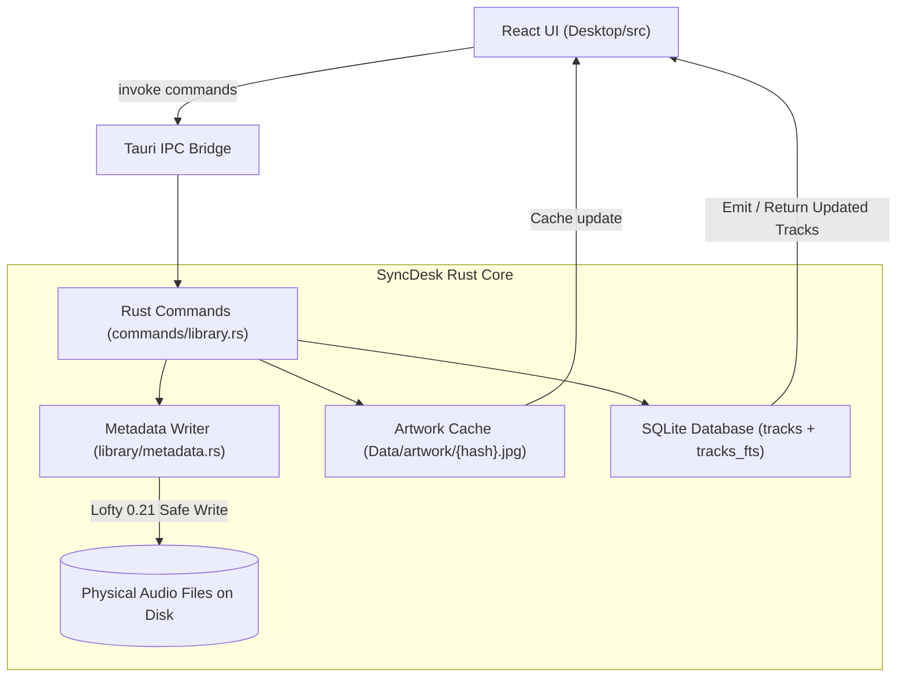

# Task Plan: Full Metadata Reader & Editor & Album Creator

**Task Slug:** `task-metadata-album-editor`  
**Date:** 2026-11-23  
**Status:** Completed  
**Assigned Agent:** `orchestrator` (with Backend, Database & Frontend Specialists)  

---

## 1. Executive Summary & Goals

This task delivers a complete, production-grade **Metadata Reader & Editor** ecosystem for **Tracks**, **Albums**, and **Playlists**, together with an **Album Creator** where users can manually assemble tracks into new albums.

### Core Objectives:
1. **Physical Audio Tag Writing (Rust / Lofty 0.21.1)**:
   - Actual mutation of audio files on disk (`.mp3`, `.flac`, `.m4a`, `.ogg`, `.wav`).
   - Atomic safe-write strategy: Write to temporary file in the target directory and rename upon validation to prevent file corruption.
   - Tag support: Title, Artist, Album, Album Artist, Track Number, Disc Number, Year, Genre, Comment, Embedded Artwork (APIC / Vorbis METADATA_BLOCK_PICTURE / MP4 covr).
2. **SQLite WAL & FTS5 Instant Sync**:
   - Immediately update SQLite `tracks` table, calculate new artwork hashes, and update the FTS5 search index without requiring a full library re-scan.
3. **Track Metadata Reader & Editor**:
   - Dedicated dialog to inspect stream/container details (format, bitrate, sample rate, channels, file size, path) and edit all writeable tags.
   - Artwork upload, preview, and removal.
4. **Album Metadata Editor**:
   - Batch-edit metadata for all tracks in an album: Album Name, Album Artist, Year, Genre, and Cover Art.
   - Atomic batch update across all files on disk with progress reporting and transaction rollback on failure.
5. **Album Creator**:
   - Dedicated flow/modal in the Library view.
   - User inputs album metadata (Title, Artist, Year, Genre, Artwork).
   - User searches and selects tracks from library or folders, reorders them, and applies track numbers.
   - Saves by rewriting all selected tracks' files on disk to bind them permanently to the new album.
6. **Playlist Metadata Reader & Editor**:
   - Comprehensive metadata viewer/editor for playlists (Name, Description, Cover image, total tracks, duration).
   - Quick access to inspect individual track metadata directly from playlist view.

---

## 2. Architecture & Data Flow

---

## 3. Detailed Component Plan

### 3.1 Backend: Rust Audio Engine & Lofty Tag Writer
- **File:** `Desktop/src-tauri/src/library/metadata.rs`
  - Implemented `write_track_metadata_to_file`:
    - Opens with `lofty::probe::Probe::open(path)?.read()?`.
    - Retrieves primary tag (or creates default tag for container type: ID3v2 for MP3, Vorbis for FLAC/OGG, MP4 for M4A).
    - Updates `title`, `artist`, `album`, `track`, `disk`, `year`, `genre`, `comment`.
    - Updates embedded front cover picture (`PictureType::CoverFront`); handles artwork removal or replacement.
    - Two-step atomic swap with backup to prevent file loss or corruption on Windows.
  - Implemented `read_detailed_metadata`:
    - Reads extensive properties: channels, sample rate, bitrate, codec, duration, bit depth, file size, all tag fields, pictures.

### 3.2 Backend: SQLite Database Updates
- **File:** `Desktop/src-tauri/src/database/mod.rs`
  - Implemented `get_track_by_id`.
  - Implemented `update_track_metadata`:
    - Updates `tracks` row with new fields (`title`, `artist`, `album`, `album_artist`, `year`, `genre`, `track_number`, `disc_number`, `has_artwork`, `artwork_hash`, `date_modified`).
    - Synchronizes `tracks_fts` FTS5 virtual table for instantaneous search consistency.

### 3.3 Backend: Tauri Commands
- **File:** `Desktop/src-tauri/src/commands/library.rs`
  - `read_track_metadata(track_id: String) -> Result<DetailedAudioMetadata, String>`
  - `update_track_metadata(track_id: String, update: TrackMetadataUpdate) -> Result<TrackRow, String>`
  - `update_album_metadata(track_ids: Vec<String>, payload: AlbumMetadataUpdatePayload) -> Result<Vec<TrackRow>, String>`
  - `create_album_from_tracks(payload: CreateAlbumPayload) -> Result<Vec<TrackRow>, String>`
  - Registered all new commands in `Desktop/src-tauri/src/lib.rs`.

### 3.4 Frontend: Types & Tauri Bridge
- **Files:**
  - `Desktop/src/types/metadata.ts`: Defined `DetailedAudioMetadata`, `TrackMetadataUpdate`, `AlbumMetadataUpdatePayload`, `CreateAlbumPayload`, `CreateAlbumTrackItem`.
  - `Desktop/src/services/tauriBridge.ts`: Added typed bridge callers `readTrackMetadata`, `updateTrackMetadata`, `updateAlbumMetadata`, and `createAlbumFromTracks`.
  - `Desktop/src/stores/useLibraryStore.ts`:
    - Added `updateTrackInStore(updatedTrack: TrackRow)`.
    - Added `updateTracksInStore(updatedTracks: TrackRow[])`.
    - Invalidation of artwork cache and reload of library stats.

### 3.5 Frontend: UI Modals & Views
- **Track Metadata Modal (`Desktop/src/features/library/components/TrackMetadataModal.tsx`)**:
  - Two tabs: **Tag Editor** (Title, Artist, Album, Album Artist, Track #, Disc #, Year, Genre, Comment) and **Audio Stream Details** (Format, Bitrate, Channels, Sample Rate, Bit Depth, Duration, File Size, File Path, Last Modified date).
  - Artwork panel: current cover preview, "Upload / Replace Cover" file picker, "Remove Cover", and preview.
  - Action buttons: "Cancel", "Save to Audio File" with loading state and toast feedback.
- **Album Creator Modal (`Desktop/src/features/library/components/AlbumCreatorModal.tsx`)**:
  - Step 1: Album Information (Album Title, Album Artist, Release Year, Genre, Album Cover art).
  - Step 2: Track Selection (Search existing library tracks, multi-select, selected tracks reordering list with Move Up/Move Down).
  - Step 3: Auto-sequence track numbers (1..N).
  - Save button: Batch-updates physical files on disk + SQLite + refreshes Album view.
- **Album Metadata Editor (`Desktop/src/features/library/components/AlbumMetadataModal.tsx`)**:
  - Accessible from `AlbumDetailModal` and `AlbumCard` via an "Edit Album" button.
  - Batch edits Album Name, Album Artist, Year, Genre, and Artwork for all tracks in the album simultaneously on disk.
- **Playlist Metadata Inspection & Editor (`Desktop/src/features/playlists/PlaylistsView.tsx`)**:
  - Direct access to inspect and edit any playlist track's metadata and rewrite audio file tags.

---

## 4. Implementation Checklist

- [x] **Phase 1: Rust Engine**
  - [x] Add metadata writing logic to `Desktop/src-tauri/src/library/metadata.rs` using Lofty 0.21.
  - [x] Add atomic two-step swap with backup and error handling.
  - [x] Add detailed stream properties reader.
- [x] **Phase 2: Database Layer**
  - [x] Add `get_track_by_id` and `update_track_metadata` in `database/mod.rs`.
  - [x] Synchronize FTS5 virtual table on update.
- [x] **Phase 3: Tauri Commands & Registration**
  - [x] Implement commands in `commands/library.rs`.
  - [x] Expose in `lib.rs` invoke_handler.
  - [x] Validate compilation with `cargo check`.
- [x] **Phase 4: Frontend State & Bridge**
  - [x] Define interfaces in `src/types/metadata.ts`.
  - [x] Update `useLibraryStore.ts` with local state updates & cache invalidation.
  - [x] Expose bridge methods in `tauriBridge.ts`.
- [x] **Phase 5: UI Components**
  - [x] Create `TrackMetadataModal.tsx`.
  - [x] Create `AlbumCreatorModal.tsx`.
  - [x] Create `AlbumMetadataModal.tsx`.
  - [x] Wire edit triggers in `TrackTable.tsx`, `TrackCard.tsx`, `AlbumCard.tsx`, `AlbumDetailModal.tsx`, `AlbumSectionList.tsx`, `LibraryView.tsx`, and `PlaylistsView.tsx`.
- [x] **Phase 6: Audio Container Auto-Detection & WAV ID3v2 Support**
  - [x] Add magic-byte sniffing (`guess_file_type()`) to handle files with mismatched extensions (e.g. MP3 saved as `.wav`).
  - [x] Add dual-tag writing for WAV files (`TagType::Id3v2` for cover art and extended ID3 tags + `TagType::RiffInfo` for text tags).
  - [x] Multi-tag extraction across `tagged_file.tags()` to extract title, artist, album, and pictures.
  - [x] Folder-level artwork fallback (`cover.jpg`, `folder.jpg`, `*.jpg`) in `library/artwork.rs`.
  - [x] Write `cover.jpg` to album folders on disk upon album cover update.
- [x] **Phase 7: Verification & Final Audit**
  - [x] Rust unit tests: `cargo test library::metadata::tests::test_wav_write_probe` passed.
  - [x] TypeScript frontend check: `npm run build` passed with 0 errors.
